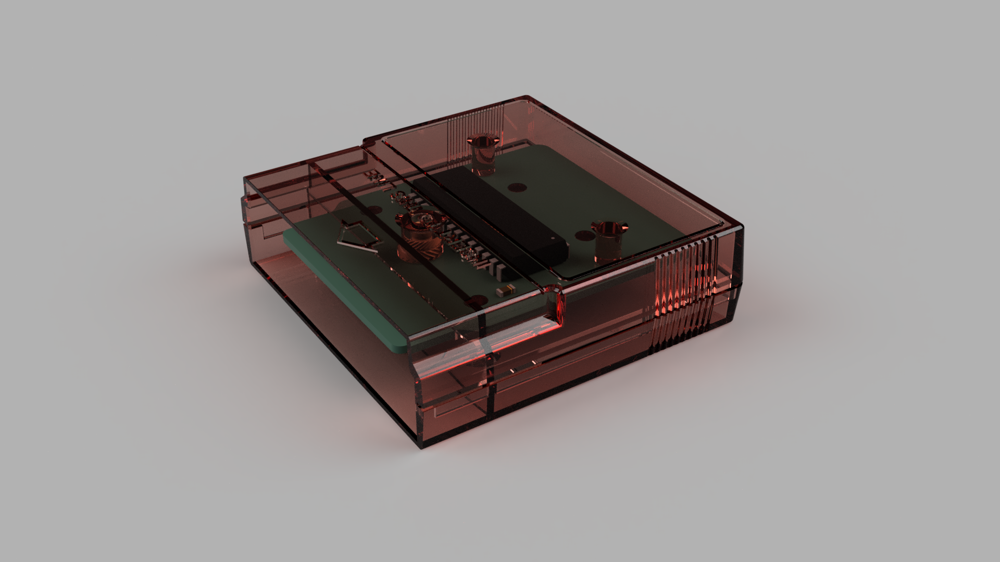
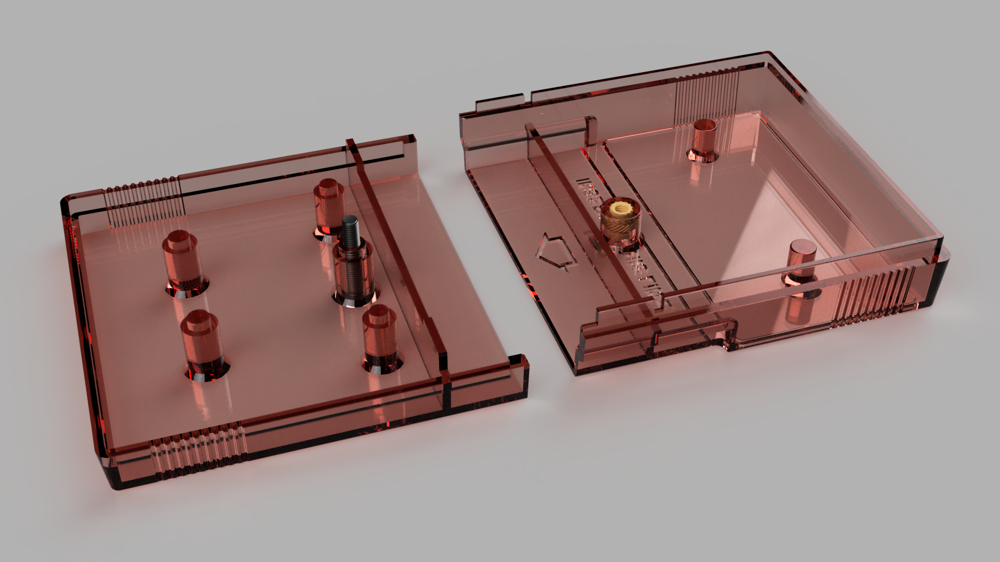
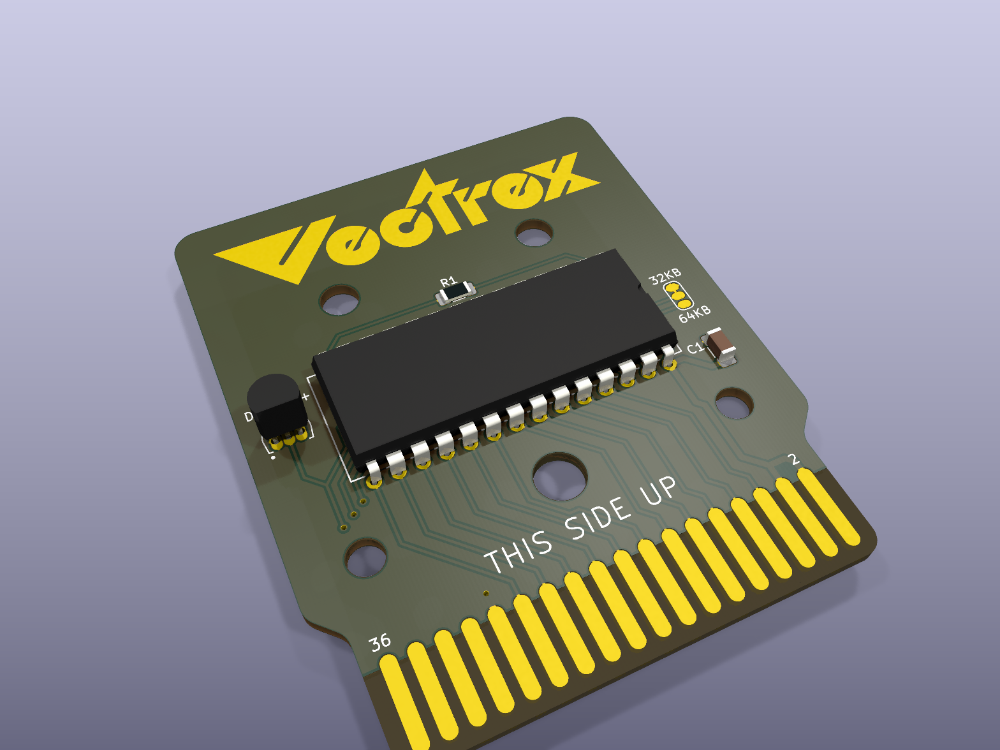
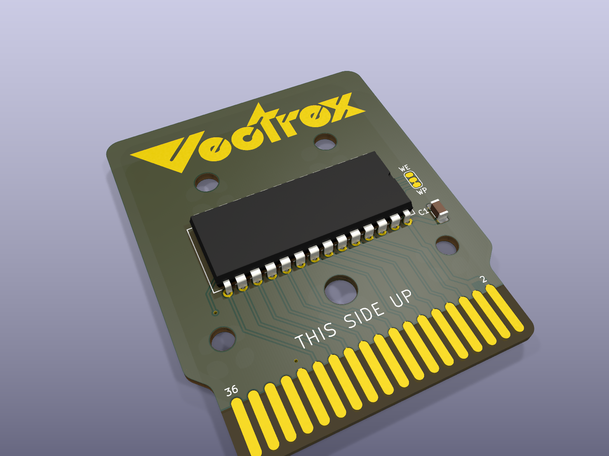

# Vectrex cartridge PCBs

**Homemade Vectrex cartridges: the boards, ready to order, and a 3D-printed shell.**

 

Cartridge boards for the Vectrex (GCE / Milton Bradley, 1982), designed in KiCad 9 to burn your own games -
homebrew, your own builds, or replacements for the original GCE releases - and a shell to put them in. Every
board has its KiCad files, Gerbers for a board maker, 3D renders, its copper layers and a schematic.

**Author:** Hugo Bokhorst ([@hugonl31](https://github.com/hugonl31)), also the author of
[Vectrex_EMU](https://github.com/hugonl31/Vectrex_EMU), which emulates these boards (bank switching, the
512K flash with its latch). 
**Documentation, schematics and renders:** made with Claude (Anthropic).

## The boards

| | Board | Chip | Size | For |
|---|---|---|---|---|
|  | [64K](boards/v1_27c512_64k) | 27C512 / W27C512 + DS2431 | 32 or 64 KB | any game up to 64 KB, with PB6 bank switching and an optional save chip |
|  | [8K GCE](boards/v1_28c64_8k_gce) | 28C64 EEPROM | 8 KB | the original GCE releases (4 or 8 KB); keep its jumper on write-protect |
|  | [512K v2](boards/v2_512k_flash) | SST39SF040 flash + 74HC377 latch | 512 KB | big bank-switched games, saving into the flash |
|  | [early boards](boards/early) | 28C64 / 27C512 | 8-32 KB | the first versions, for reference |

All boards share one outline (54 x 66 mm, 1.6 mm, ENIG, bevelled edge fingers), so they all fit the
[shell](case).

## How a Vectrex cartridge works

The cartridge port is a 36-finger edge connector. The Vectrex's 6809 CPU sees the cartridge in a **32 KB
window, $0000-$7FFF**: address lines A0-A14 and data lines D0-D7 go straight to the memory chip, with /CE and
/OE. Most original games fit in 4 or 8 KB and simply repeat through the window.

Bigger games switch **banks**: they swap which part of a larger chip is in the window. The port carries one
line the game controls for that, **PB6** (finger 35) from the Vectrex's 6522 VIA; the 64K board puts it on the
chip's A15 (two 32 KB banks). The 512K board adds a latch: a write into $0000-$3FFF stores three more address
bits, A16-A18, for 16 banks - see its [README](boards/v2_512k_flash).

The port also has R/W (writes), /CART, /HALT, /NMI and /IRQ, +5 V and GND. The pinout, as the boards use it
(odd fingers on one side, even on the other):

| Finger | Signal | Finger | Signal | Finger | Signal | Finger | Signal |
|---|---|---|---|---|---|---|---|
| 1 | /HALT | 10 | A11 | 19 | D0 | 28 | GND |
| 2 | +5V | 11 | A3 | 20 | D6 | 29 | A12 |
| 3 | A7 | 12 | /OE | 21 | D1 | 30 | R/W |
| 4 | +5V | 13 | A2 | 22 | D5 | 31 | A13 |
| 5 | A6 | 14 | A10 | 23 | D2 | 32 | /CART |
| 6 | A8 | 15 | A1 | 24 | D4 | 33 | A14 |
| 7 | A5 | 16 | /CE | 25 | GND | 34 | /NMI |
| 8 | A9 | 17 | A0 | 26 | D3 | 35 | PB6 |
| 9 | A4 | 18 | D7 | 27 | GND | 36 | /IRQ |

## The schematics

The boards were drawn directly in KiCad's PCB editor, so there are no KiCad schematic sheets. Each board's
`images/schematic.svg` is drawn from the board file itself: every part with its pin names, each pin ending in
its net name (pins with the same name are connected). It always matches the board, because it is made from it.

## Making one

1. **Order the board:** upload the board's `*-gerbers.zip` to JLCPCB, PCBWay or similar. 1.6 mm; ENIG (gold)
   is worth it for the edge fingers; ask for the 45 degree bevel on the finger edge if they offer it.
2. **Program the chip** with a TL866 / T48 (XGecu) or similar - each board's README says how.
3. **Solder** it (all through-hole chips, 1206 passives: easy by hand) and **print the [shell](case)**.

## Repository

| Path | |
|---|---|
| `boards/` | one folder per board: KiCad files, Gerbers, `images/` (renders, copper, schematic), a README |
| `case/` | the shell's STL files and renders |
| `libs/` | the KiCad footprints and symbols the boards use (edge connector, mounting holes, Vectrex logos) |

Open a board's `.kicad_pro` in KiCad 9; its library tables point to `libs/`.

## License

The board designs, the shell and the documentation: [CERN-OHL-P-2.0](LICENSE.md) - use, change, make and sell
them, keep the notice. Vectrex and its logo are trademarks of their owners; this project is not affiliated
with them. Datasheets and vendor 3D models are not included (the boards use KiCad's standard models).
