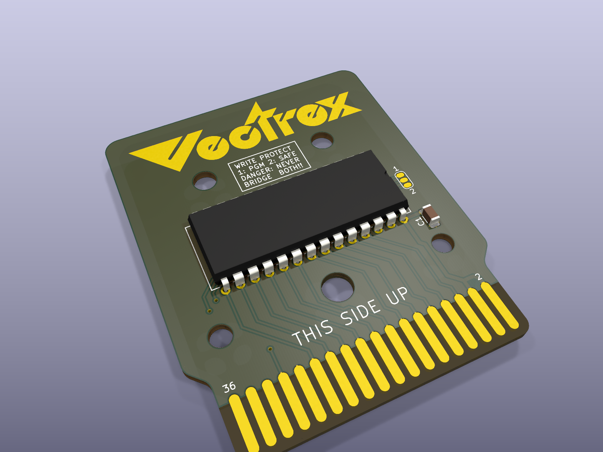
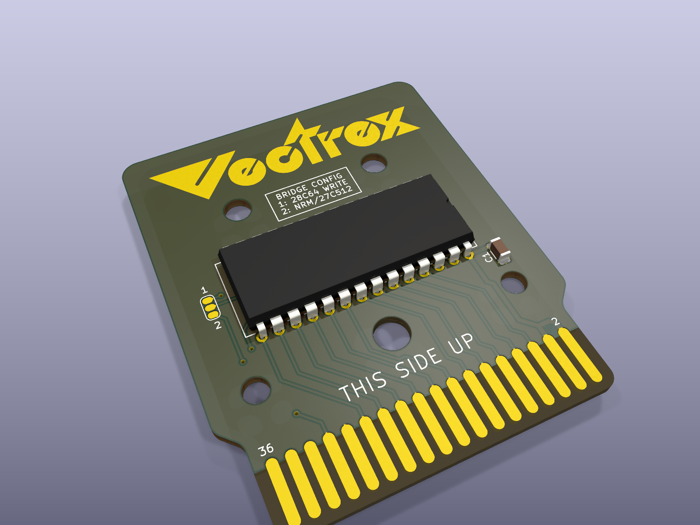
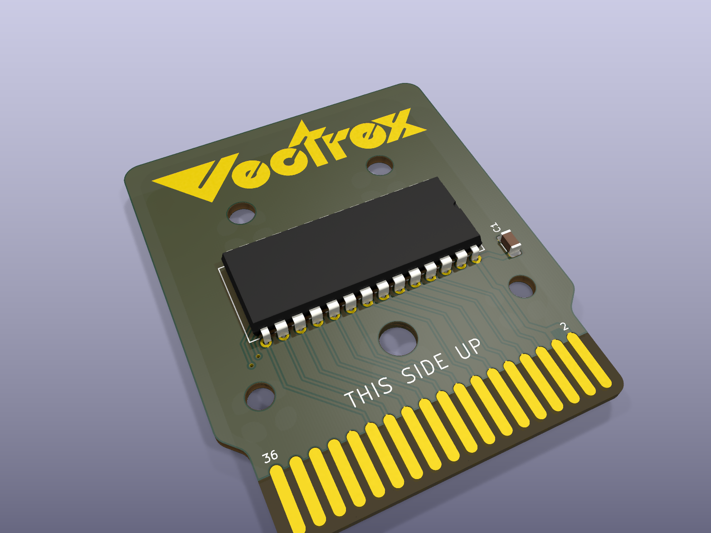

# Early boards

The first versions, from November 2024, on the way to the [64K board](../v1_27c512_64k) and the
[8K GCE board](../v1_28c64_8k_gce). Kept for reference: same outline and edge fingers, simpler circuits.
Each folder has the KiCad board, Gerbers, renders, the copper layers and a schematic drawn from the board.

| | Board | |
|---|---|---|
|  | [a_28c64](a_28c64) | a 28C64 (8 KB EEPROM); a 3-pad jumper on /WE |
|  | [b_duo_28c64_27c512](b_duo_28c64_27c512) | one board for a 28C64 **or** a 27C512: the bridge chooses what pin 27 gets (the 28C64's /WE or the 27C512's A14) |
|  | [c_27c512](c_27c512) | a plain 27C512 for 32 KB games, no bank switching (the EPROM's A15, pin 1, has no connection here: tie it to GND for a 32 KB image in the first half) |

The 64K board replaced the last two: A15 on a jumper (32KB / 64KB with PB6 banking) and a DS2431 for saves.
