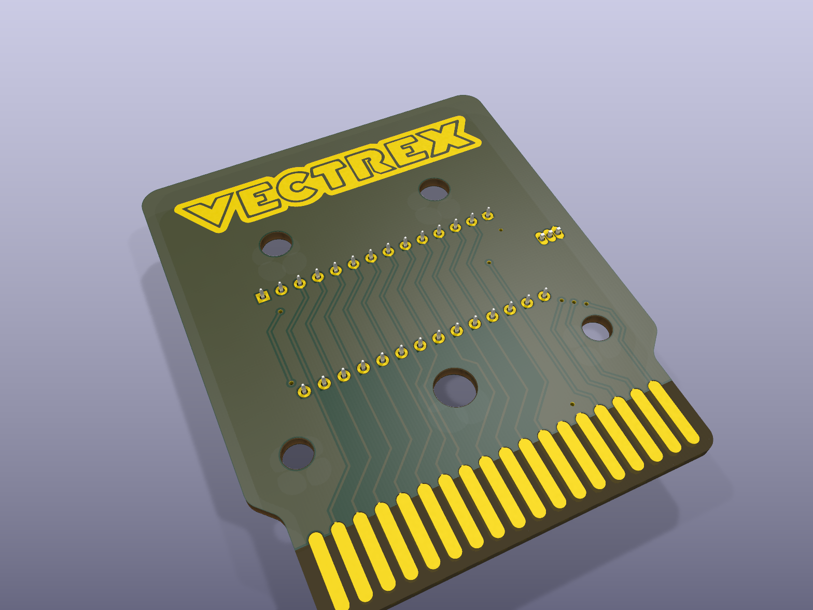

# 64K cartridge - 27C512 / W27C512 with a DS2431 save chip

The main board: any Vectrex game up to 64 KB, on a 27C512 EPROM or a Winbond W27C512 (electrically erasable:
no UV lamp, the programmer erases it). 54 x 66 mm, 2 layers, 1.6 mm, ENIG, bevelled edge fingers.

**Schematic:** [images/schematic.svg](images/schematic.svg) (drawn from the board's own connections) -
**copper:** [front](images/pcb_front.svg), [back](images/pcb_back.svg).

| File | |
|---|---|
| `vectrex-cartridge-64k.kicad_pcb` / `.kicad_pro` | the board (KiCad 9) |
| `vectrex-cartridge-64k-gerbers.zip` | Gerbers + drill files, ready for JLCPCB, PCBWay... |
| `images/` | renders, copper layers, schematic |

## Parts

| Ref | Part | |
|---|---|---|
| U1 | 27C512 or W27C512 (DIP-28) | the game; a socket is handy while developing |
| U2 | DS2431 (TO-92) | optional: a 1 Kbit 1-Wire EEPROM on PB6, for high scores and settings |
| R1 | 3.3 kOhm, 1206 | pull-up on PB6 |
| C1 | 100 nF, 1206 | decoupling |
| JP1 | solder jumper, 3 pads | 32KB / 64KB (below) |

## How it works

The Vectrex's cartridge window is 32 KB ($0000-$7FFF): the port's A0-A14. A 27C512 holds 64 KB, so its
fifteenth address line, **A15**, picks one of two 32 KB halves (banks). **JP1** sets it:

* **32KB** (A15 to GND): a plain 32 KB (or smaller) game. Program the image into the chip's first half.
* **64KB** (A15 to PB6): a bank-switched 64 KB game. PB6 is a line of the Vectrex's 6522 VIA that reaches the
  cartridge port (pin 35); the game switches banks by driving it (DDRB bit 6 as an output, ORB bit 6 the bank).
  **R1** pulls PB6 up, so while it is still an input it reads 1: the cartridge powers up in bank 1. The boot
  code must be where the game starts (the usual 64 KB images are laid out that way).

**U2, the DS2431**, sits on PB6 too: a 1-Wire memory (1024 bits) a game can talk to through that same line,
for saving high scores. Leave it out if the game doesn't use it.

The EPROM's /CE and /OE come straight from the port (pins 16 and 12), its data lines D0-D7 and address lines
A0-A14 too. Nothing else is needed: no logic chips.

## Programming

A TL866 / T48 (XGecu) or any programmer that does 27C512s. A W27C512 is erased by the programmer (it needs
its 14 V erase voltage), so no UV eraser. Program the game's .bin as it is: a 32 KB image into the first
half (jumper on 32KB), a 64 KB image whole (jumper on 64KB).

## Ordering

Upload `vectrex-cartridge-64k-gerbers.zip` to the board maker. 1.6 mm, ENIG (gold) is worth it for the edge
fingers, with a 45 degree chamfer on the finger edge if they offer it ("edge connector bevelling").
