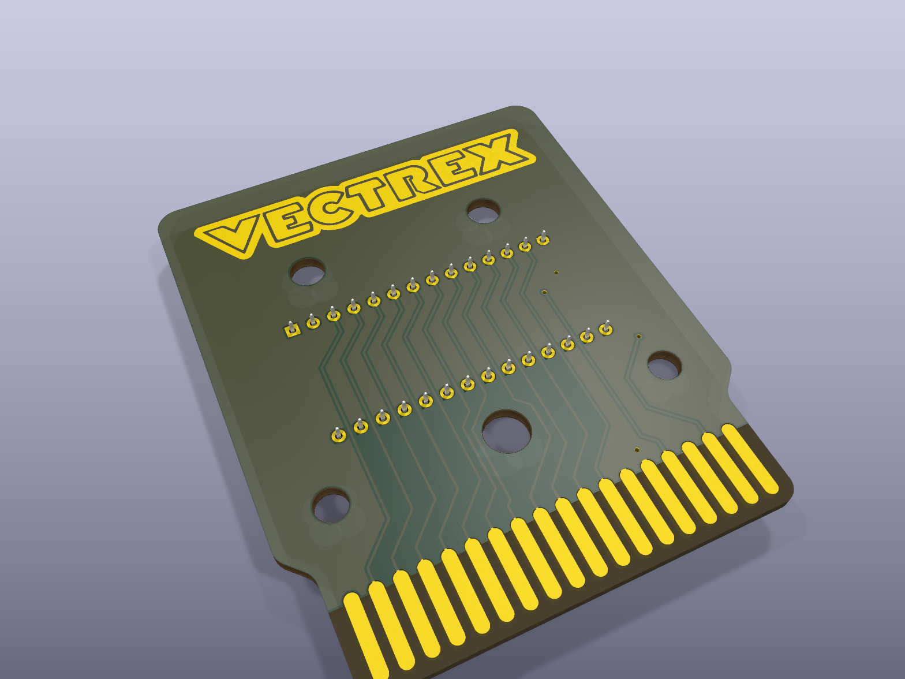

# 8K cartridge for the original GCE games - 28C64 EEPROM

A board for the **original GCE releases**: they are 4 KB or 8 KB, so one 28C64 (8 KB, electrically erasable,
5 V only) holds any of them. 54 x 66 mm, 2 layers, 1.6 mm, ENIG, bevelled edge fingers - the same outline as
the 64K board.

**Schematic:** [images/schematic.svg](images/schematic.svg) (drawn from the board's own connections) -
**copper:** [front](images/pcb_front.svg), [back](images/pcb_back.svg).

| File | |
|---|---|
| `vectrex-cartridge-8k-gce.kicad_pcb` / `.kicad_pro` | the board (KiCad 9) |
| `vectrex-cartridge-8k-gce-gerbers.zip` | Gerbers + drill files |
| `images/` | renders, copper layers, schematic |

## Parts

| Ref | Part | |
|---|---|---|
| U1 | 28C64 (DIP-28), e.g. AT28C64B | the game |
| C1 | 100 nF, 1206 | decoupling |
| JP1 | solder jumper, 3 pads: **WE** / **WP** | the 28C64's /WE (below) |

## How it works

A0-A12, D0-D7, /CE and /OE come straight from the cartridge port. An 8 KB game repeats through the 32 KB
cartridge window - the Vectrex doesn't mind, the original cartridges do the same.

**The write protection matters.** A 28C64 is writable in place: its /WE pin (27) writes the chip whenever it
goes low while the chip is selected. JP1 connects it:

* **WP** (/WE to +5 V): **write-protected - keep it here.** The game can never change the chip.
* **WE** (/WE to the port's R/W line): any write the game makes into the cartridge area would land in the
  EEPROM and corrupt the game. Only for experiments; check the routing first (KiCad's design check reports
  the R/W track at edge finger 33, normally A14, instead of finger 30).

## Programming

Any programmer that does 28C64s (TL866 / T48...): 5 V only, no erase step. Program the 4 KB or 8 KB image as
it is.
