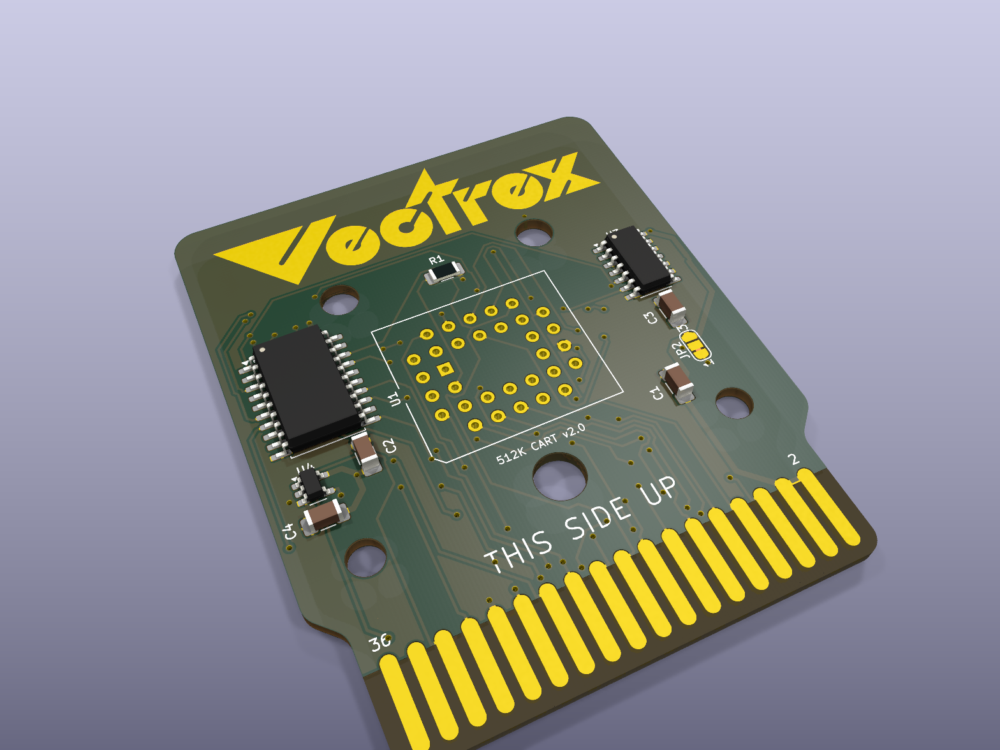
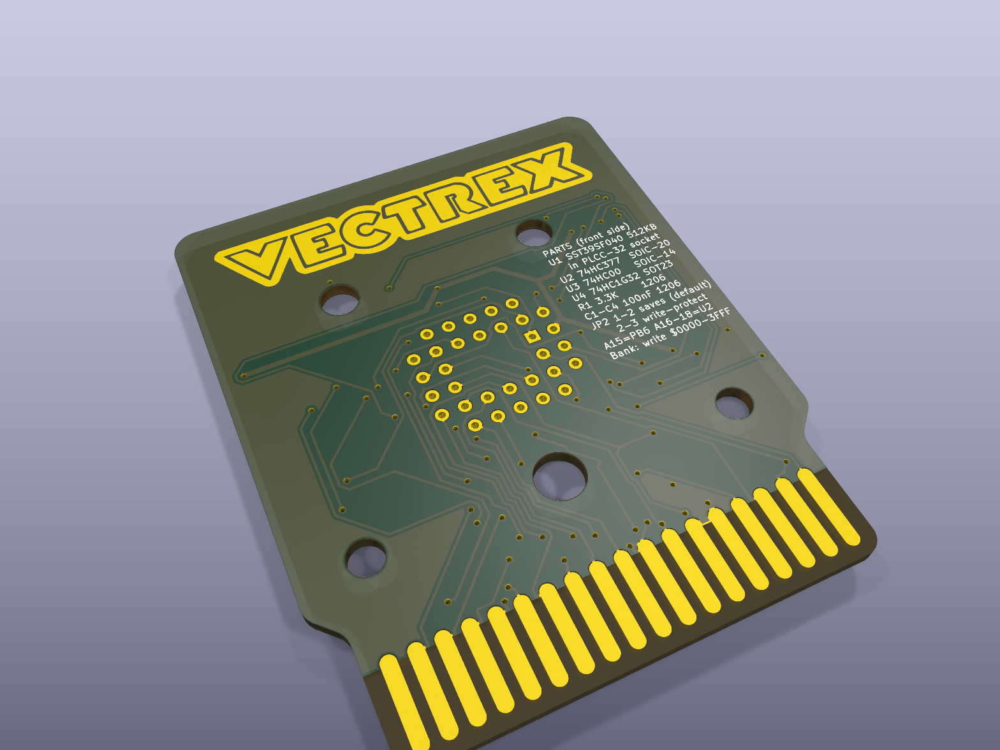

# Vectrex cartridge v2.0 - 512 KB flash with a bank latch

**Schematic:** [images/schematic.svg](images/schematic.svg) (drawn from the board's own connections) -
**copper:** [front](images/pcb_front.svg), [back](images/pcb_back.svg).

Built from the v1 64K board (`../v1_27c512_64k`): the same outline, edge fingers, Vectrex
logos (front and back), mounting holes, GND fill and "THIS SIDE UP". 54 x 66 mm, 2 layers.

| File | |
|---|---|
| `vectrex-cartridge-512k.kicad_pcb` / `.kicad_pro` | the board (open in KiCad 9) |
| `vectrex-cartridge-512k-gerbers.zip` | Gerbers + drill files for the board maker (JLCPCB, PCBWay...) |
| `images/` | 3D renders, the copper layers (`pcb_front.svg`, `pcb_back.svg`) and the schematic |
| `make_board.py` | builds the board from v1 (parts, nets, placement) - KiCad's Python |
| `route.py` | export to / import from Freerouting (the autorouter used) |
| `silk.py` | the part names on the silkscreen |

## Circuit

| Part | Connections |
|---|---|
| **U1** SST39SF040 (512 KB flash) in a PLCC-32 socket | A0-A14, D0-D7 from the cartridge port. **A15 = PB6** (port pin 35, as on v1), **A16 / A17 / A18 = U2 Q0 / Q1 / Q2**. /CE = port pin 16. /OE = U3 (below). /WE = JP2. |
| **U2** 74HC377 bank latch (SOIC-20W) | D1-D8 = data bus D0-D7, CLKEN (pin 1) = R/W (port 30), CLK (pin 11) = U4 (/CART OR A14). A write to $0000-$3FFF stores the bank number. 1Q-3Q = A16-A18; 4Q-8Q free (for later, e.g. a 1 MB chip has no more pins - spare outputs for LEDs or more chips). |
| **U3** 74HC00 (SOIC-14) | gate 1: E = NAND(/OE pin 12, /OE pin 12); gate 2: flash /OE = NAND(E, R/W). The flash only drives the bus when the CPU reads - the datasheet (table 4-1) says that with /OE low it may drive the bus even during a write, which would fight the CPU writing the bank number. Gates 3 and 4: inputs to GND. |
| **U4** 74HC1G32 OR gate (SOT-23-5) | latch clock = /CART OR A14: only writes to the lower 16 KB ($0000-$3FFF) reach the latch (pin 1 /CART, 2 A14, 3 GND, 4 out, 5 +5 V). |
| **R1** 3.3K pull-up | on PB6 = A15, as v1: a defined bank from power-on. |
| **JP2** solder jumper (flash /WE) | printed bridge **1-2: /WE = R/W, the game can save into the flash** (default). Cut 1-2 and bridge 2-3: /WE to +5 V = write-protected. |
| **C1-C4** 100 nF | one per chip. |

No DS2431 any more: high scores and settings are saved in the flash itself.

### How the game switches banks

The cartridge window is 32 KB ($0000-$7FFF). Bank = A18 A17 A16 A15:

* **A15** is PB6 of the VIA, as on v1: `DDRB` bit 6 output + `ORB` bit 6 (input = pulled high = 1).
* **A16-A18**: write a byte to **any address in $0000-$3FFF**; its bits 0-2 become A16-A18 at the end of the
  write cycle. `sta $0000` with A = bank >> 1 is enough. Writes to $4000-$7FFF never change the bank.
* The 74HC377 has no reset: after power-on (and after the Vectrex RESET button) A16-A18 can be anything.
  So the boot code - the cartridge header at $0000 and the first instructions until the latch is written -
  must be the same in every bank where the game can start: all 8 latch values with PB6 = 1 (the 8 odd
  banks). A game made for the 64K board already keeps such a shared area in both of its banks; here it becomes 8 copies.
* Code that switches banks must run from a place that is the same in both banks (as now), or from RAM.

### Saving into the flash (high scores, settings)

The flash's commands are writes to $5555 and $2AAA (only A0-A14 count). With U4, $5555 (A14 = 1) never
clocks the latch, but $2AAA (A14 = 0) does, and its data byte is always `$55` = A16-A18 **101**. So during
every program and erase command the flash sees bank A16-A18 = 101 - always the same bank, so:

* Keep the save area in **$4000-$7FFF of a bank with A16-A18 = 101** (banks 10 and 11, by PB6), in its own
  4 KB sector(s) - nothing else in those sectors.
* Byte program: `$AA`->$5555, `$55`->$2AAA, `$A0`->$5555, data -> address (~20 us).
  Sector erase: `$AA`->$5555, `$55`->$2AAA, `$80`->$5555, `$AA`->$5555, `$55`->$2AAA, `$30`->sector (~25 ms).
* The code doing this must run from RAM (the flash can't be read while it's busy), with PB6 set for the save
  bank; finish by writing the game's bank number back to $0000-$3FFF.
* 100 000 erase cycles per sector, ~100 years retention. Use two sectors in turn with a counter + checksum, so
  a power cut in the middle of a save always leaves the previous save.
* JP2 2-3 makes the flash read-only (e.g. a collector's copy).

## Parts (digikey.at, October 2026)

| Ref | Part | DigiKey no. | Price |
|---|---|---|---|
| U1 | Microchip SST39SF040-55-4C-NHE-T (512 KB, PLCC-32, 55 ns) | SST39SF040-55-4C-NHE-TCT-ND | 2.58 EUR |
| U1 socket | Assmann A-CCS 032-Z-T (PLCC-32, through hole) | AE11106-ND | 1.86 EUR |
| U2 | TI SN74HC377DWR (SOIC-20W) - or SN74HCT377DW (see below) | 296-9818-1-ND | 0.76 EUR |
| U3 | TI SN74HC00DR (SOIC-14) - or SN74HCT00DR | search "SN74HC00DR" | 0.35 EUR |
| U4 | TI SN74AHCT1G32DBVR (SOT-23-5) | search "SN74AHCT1G32DBVR" | ~0.3 EUR |
| R1 | 3.3 kOhm 1206 | as v1 | |
| C1-C4 | 100 nF 1206 | as v1 | |
| | PLCC-32 to DIP-32 adapter for the XGecu programmer | AliExpress / eBay | |

**HC or HCT?** The 6809 and the VIA are NMOS chips: their "high" can be as low as 2.4 V, below what 74HC inputs
need at 5 V (3.5 V). In practice it usually works (they pull up close to 5 V with the light cartridge load), but
the HCT versions (TTL input levels, same pins, same price range) are the safe choice for all three logic chips.

The SST39SF020A (256 KB) and SST39SF010A (128 KB) fit the same socket: with them A18 (and A17) are not
connected inside the chip, the banks just repeat.

## Checks

* KiCad 9 DRC: no unconnected items. Remaining, accepted: the edge fingers share one solder-mask opening
  (as v1); a silkscreen label touches a finger's pin number and JP2's "3" touches its pad.
* No vias under the back's parts legend.
* No tracks in the fingers' contact area (both sides): tracks only meet a finger at its top 1.6 mm.
* Pinouts checked against the datasheets: SST39SF040 (DS20005022, PLCC-32 = JEDEC numbering), SN74HC377
  (SCLS307D), SN74HC00 (SCLS181H).
* Timing to confirm on the first board: the latch clocks on /CART rising (end of the write); the 6809 holds
  the data ~30 ns after E falls, the 74HC377 needs ~5 ns hold - fine on paper, worth a first test with a
  bank-switch test cartridge before building more.
